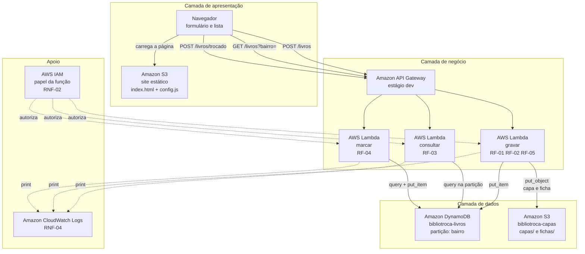

# Diagrama de arquitetura — BiblioTroca

Entregável da Sprint 2, seção 5. O GitHub renderiza o bloco abaixo como
imagem ao abrir este arquivo.

## Como ler

As setas cheias são o caminho do dado. As pontilhadas são autorização e
registro: não carregam dado do usuário, mas sem elas nada funciona e
nada é auditável.

Repare que **nenhuma seta liga o navegador diretamente à tabela ou ao
bucket**. Esse é o desenho da separação em três camadas descrito na
seção 2.1 do documento de arquitetura: o único caminho até os dados
passa pelo API Gateway e por uma função.

Repare também que a função `gravar` tem duas setas de saída, e a ordem
importa: primeiro o bucket, depois a tabela. É o requisito de
Reliability do FURPS — não pode sobrar um livro listado apontando para
uma imagem que nunca subiu.
